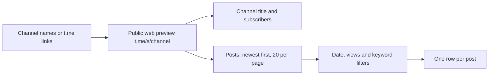

# Telegram Channel Scraper: Posts, Views, Reactions and Subscribers

[](https://apify.com/Turboextract/telegram-channel-scraper)
[](LICENSE)
[](#pricing)

**Get posts from any public Telegram channel: text, date, views, reactions, links, hashtags and media flags, plus the channel's title and subscriber count.** No Telegram account, no phone number and no API keys. Paste channel names or t.me links and get a clean table.

In one test, the actor read 30 posts each from @durov (9.95M subscribers) and @telegram (9.1M) in a few seconds, with view counts like 895,000 on a single post.

**Try it now →** [apify.com/Turboextract/telegram-channel-scraper](https://apify.com/Turboextract/telegram-channel-scraper)

---

## Why this exists

- Telegram channels are where crypto, news and niche communities post first.
- The official API needs a phone number, an app ID and a logged-in session.
- Views and reactions per post are the best signal of a channel's real reach, but there is no export.
- Telegram analytics tools charge monthly per channel.

---

## Who this is for

- **Crypto and trading researchers** tracking signal and announcement channels
- **Media monitors and journalists** following news channels in any language
- **Marketers** comparing channel growth, post views and engagement before buying ads
- **Brand and security teams** watching for mentions, leaks or scams
- **AI and data teams** building datasets from public channel posts

---

## What you get per post

```json
{
  "postId": 564,
  "url": "https://t.me/durov/564",
  "date": "2026-11-17T19:12:44.000Z",
  "text": "Telegram bots and mini apps can accept only Stars (*Grams) for digital services...",
  "views": 895000,
  "reactions": [{ "emoji": "⭐", "count": 2080000 }, { "emoji": null, "count": 28600 }],
  "reactionsTotal": 2126350,
  "links": ["https://fragment.com/stars/buy"],
  "hashtags": [],
  "hasPhoto": false,
  "hasVideo": false,
  "isForwarded": false,
  "forwardedFrom": null,
  "channel": "durov",
  "channelTitle": "Pavel Durov",
  "channelSubscribers": 9950000,
  "channelUrl": "https://t.me/durov"
}
```

---

## How it works



Every public Telegram channel has a web preview at `t.me/s/<channel>`. The actor reads it page by page, newest posts first, until it reaches your limit or date window.

---

## Quick start

1. Click **Try for free**.
2. Add **Channels**, like `durov`, `@telegram` or `https://t.me/s/bbcnews`.
3. Optional: set **Max posts per channel**, **Posted within (days)** or **Text must contain**.
4. Click **Start**, then export to CSV, JSON or Google Sheets. Schedule it to collect new posts every hour.

### API

```bash
curl -X POST "https://api.apify.com/v2/acts/Turboextract~telegram-channel-scraper/run-sync-get-dataset-items?token=YOUR_TOKEN" \
  -H "Content-Type: application/json" \
  -d '{
    "channels": ["durov", "telegram"],
    "maxPostsPerChannel": 50
  }'
```

### Python

```python
from apify_client import ApifyClient

client = ApifyClient("YOUR_TOKEN")
run = client.actor("Turboextract/telegram-channel-scraper").call(run_input={
    "channels": ["durov"],
    "postedWithinDays": 7,
    "minViews": 100000,
})
for p in client.dataset(run["defaultDatasetId"]).iterate_items():
    print(p["date"], p["views"], p["url"])
```

---

## Input fields

| Field | Default | What it does |
|---|---|---|
| `channels` | – | Usernames, @handles or t.me links |
| `maxPostsPerChannel` | 50 | Newest posts first |
| `postedWithinDays` | 0 (all) | Only posts from the last N days |
| `keywords` | – | Post text must contain one of these |
| `minViews` | 0 | Skip posts with fewer views |
| `includeChannelInfo` | true | Add title, subscribers and link to each row |
| `maxResults` | 1000 | Total cap per run |

---

## Pricing

**$0.003 per post delivered.** The last 50 posts from 20 channels (1,000 posts) cost $3.

| Option | 1,000 posts |
|---|---|
| **Telegram Channel Scraper** | **$3**, no login or phone number |
| Other Telegram actors on Apify | $3 to $10, some need a session |
| Telegram analytics tools | $30 to $100+ a month |

---

## Common use cases

- **Channel benchmarking**: average views per post across 50 channels in a niche
- **Crypto and news alerts**: hourly runs with keywords like a token or company name
- **Ad buying research**: views versus subscribers to spot inflated channels
- **Link harvesting**: every URL a channel shared this month
- **Datasets**: post text with dates and engagement for analysis or AI training
- **Scam and leak monitoring**: alerts when a brand name shows up in public channels

---

## Tips for best results

- Use the channel username from its t.me link. Private channels, groups and bots have no public preview.
- Combine `postedWithinDays: 1` with a schedule and dedupe on `url` for a live feed.
- Custom emoji reactions show their count with `emoji: null`. Star reactions show as ⭐.

---

## Pairs well with

- [Google News Scraper](https://apify.com/Turboextract/google-news-feed): news articles by search or topic
- [Bluesky Scraper](https://apify.com/Turboextract/bluesky-posts-profiles): Bluesky posts and profiles by keyword
- [Substack Scraper](https://apify.com/Turboextract/substack-newsletter-scraper): newsletter posts with likes and comments

---

## FAQ

**Do I need a Telegram account?** No. The actor reads the same public web preview anyone can open in a browser.

**Can it read private channels or groups?** No. Only public channels with a web preview.

**How far back can it go?** As far as the channel's history goes. Set a high `maxPostsPerChannel` for the full archive.

**Does it download media?** It flags photos, videos and documents and gives the post link. It doesn't download files.

**Is it legal?** It reads posts the channel owner chose to publish publicly. Follow Telegram's terms and your local laws when you use the data.

---

## SEO keywords

Telegram channel scraper, Telegram scraper, scrape Telegram posts, Telegram channel API, Telegram messages export, Telegram views data, Telegram channel analytics, t.me scraper, Telegram crypto channels, Telegram monitoring

---

## Support

- Actor page: https://apify.com/Turboextract/telegram-channel-scraper
- Issues and questions: open an issue in this repo
- Community Discord: https://discord.gg/8SrXSCpvgj

Built and maintained by [Turboextract](https://apify.com/Turboextract) on the Apify platform.

---

## License

The documentation and examples in this repository are MIT licensed. The actor itself runs on the Apify platform.
